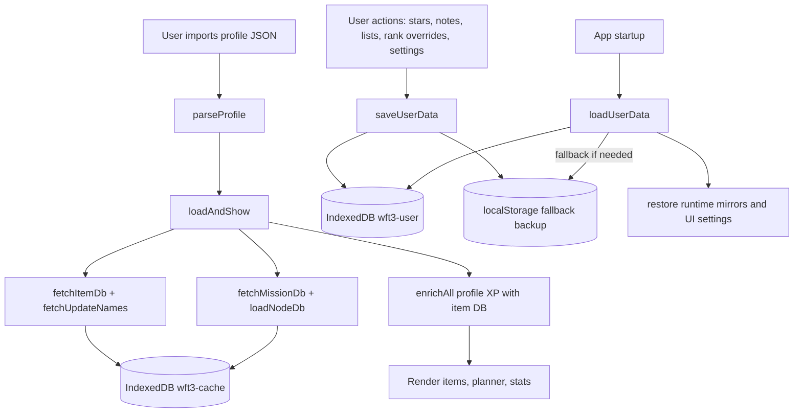

# Project Structure and Data Flow (Current)

## 1) What "database" means in this project

This app does not use a server-side database.

It runs fully in the browser and uses:
- IndexedDB for structured local storage
- localStorage for small values and fallback backup
- Remote JSON sources only for read-only data fetches

Runtime DBs are created client-side via IndexedDB.open:
- `wft3-cache` (object store: `cache`)
- `wft3-user` (object store: `user`)

Implementation references:
- `openCacheDB()` and `openUserDB()` in `js/app.js`

## 2) End-to-end data flow

## 3) Database creation method and when it happens

### IndexedDB creation
- Method: `indexedDB.open(name, version)`
- Trigger: first call to DB helper functions in a browser session
- Object stores are created in `onupgradeneeded`:
  - `wft3-cache` -> `cache`
  - `wft3-user` -> `user`

Where this is defined:
- `js/app.js` in `openCacheDB()` and `openUserDB()`

### Cache records schema (in `cache` store)
Each cache entry is stored as:
- `k`: key (string)
- `v`: payload (object)
- `t`: write timestamp (Date.now ms)

Written through:
- `dbSet('cache', key, value)`

### User records schema (in `user` store)
Main user payload is stored under key `userData`:
- object shape: `{ k: 'userData', v: ST.userData, t: timestamp }`

Written through:
- `userDbSet('userData', ST.userData)` via `saveUserData()`

## 4) How often data is created/refreshed

### On app load
- `window.load` -> `loadUserData()` always runs
- If localStorage has `wft3_profile`, app auto-parses it and runs `loadAndShow()`

### Cache refresh frequency (TTL-based)
Current constants in code:
- `CACHE_TTL = 7 days`
- `MISSION_DB_TTL = 30 days`

What this affects:
- `item_db` cache validity: 7 days
- `update_names` cache validity: 7 days
- `node_db` cache validity: 7 days
- `mission_db` cache validity: 30 days

Behavior:
- If cached value exists and `Date.now() - t < TTL`, use cache
- Otherwise fetch remote source and overwrite cache entry

### User data write frequency
`saveUserData()` is called on many UI events, including:
- star/unstar
- notes edits
- rank overrides
- list create/delete/add
- planner settings changes
- manual intrinsic/plexus values
- end of `loadAndShow()` sync

Effective frequency:
- Event-driven (immediate writes per action)
- No debounce or batch queue at present

## 5) Where user data is stored

### Primary storage
- IndexedDB DB: `wft3-user`
- Object store: `user`
- Key: `userData`
- Payload: `ST.userData` (versioned; currently version 3)

### Fallback/backup storage
- localStorage key: `wft3_userdata`
- Purpose: recovery if IndexedDB user store was cleared
- Recovery path: `loadUserData()` loads localStorage fallback, then rehydrates IndexedDB

### Other localStorage keys in use
- `wft3_playerid`: saved player ID for refresh flow
- `wft3_profile`: last imported raw profile JSON (used for auto-restore on reload)
- `wft3_calc_open`: UI state for calculator panel open/closed
- Legacy migration keys read/removed by `migrateOldData()`:
  - `wft3`
  - `wft3_overrides`
  - `wft3_sp`

## 6) External data sources (read-only)

Fetched at runtime when cache is stale/missing:
- Item database JSON:
  - `https://raw.githubusercontent.com/wfcd/warframe-items/master/data/json/All.json`
- Update names/patchlogs:
  - `https://raw.githubusercontent.com/WFCD/warframe-patchlogs/master/data/patchlogs.json`
- Star chart nodes:
  - `https://raw.githubusercontent.com/WFCD/warframe-worldstate-data/master/data/solNodes.json`
- Mission metadata (wiki parse endpoint):
  - `https://wiki.warframe.com/api.php?action=parse&page=Module:Missions/data&prop=wikitext&format=json&origin=*`

User profile source (manual fetch by user):
- `http://content.warframe.com/dynamic/getProfileViewingData.php?playerId=...`

## 6.1) Explicit consumed fields (star chart pipeline)

This section lists fields currently consumed by code for star chart construction.

### A) `solNodes.json` (WFCD worldstate nodes)

Consumed:
- Object key/tag from `Object.entries(nodeDb)` (used as node ID, e.g. `SolNode130`)
- `node.type` or `node.missionType` (mission type inference)
- `node.value` (parsed into display name and optional planet suffix)
- `node.planet` (primary planet source)
- `node.systemName` (planet fallback source)

Not currently consumed:
- `uniqueName`
- `name`
- `systemIndex`
- `nodeType`
- `masteryReq`
- `missionIndex`
- `factionIndex`
- `minEnemyLevel`
- `maxEnemyLevel`

### B) Wiki parse mission DB (`Module:Missions/data`)

Consumed per node:
- `InternalName` (key)
- `Name`
- `Planet`
- `Type`
- `Enemy`
- `MinLevel`
- `MaxLevel`
- `MasteryExp`

Used for:
- Node display metadata enrichment (type/enemy/levels)
- Mastery XP per node

### C) Imported player profile (`Missions` array)

Consumed per mission row:
- `Tag` (node ID mapping)
- `Tier` (Steel Path inference)
- `Completes` (completion count shown in node detail)

## 7) How warframe/weapon names, metadata, and recipes are extracted

This project has two separate extraction paths:
- Runtime extraction (used by the live app UI)
- Testharness extraction (used for research/audits, not required for normal app use)

### 7.1 Runtime extraction (names + metadata used in app)

Source feed:
- `https://raw.githubusercontent.com/wfcd/warframe-items/master/data/json/All.json`

High-level pipeline:
1. `fetchItemDb()` downloads (or cache-loads) the raw item list.
2. Each item is classified through `classifyItem(item)`.
3. Non-gameplay/junk entries (glyphs, cosmetics, many components, etc.) are excluded.
4. Category overrides/rescues are applied for known edge cases (Zaws, Kitguns, MOAs, Hounds, etc.).
5. Entries are deduplicated by lowercase item name, keeping the highest-score candidate.
6. Final normalized map is stored as `item_db` in IndexedDB cache.

What is kept for each final item record:
- `name`
- `apiCat` (normalized gameplay category)
- `introduced` (update/version label text)
- `majorUpdate` (parsed major version)
- `maxRank` (30 or 40 based on item rules)

Dedup logic details:
- A score is computed from mastery value plus heuristics.
- Newer/clearer canonical entries are preferred.
- NPC-like entries are penalized.
- Winner per unique lowercase name is persisted.

Resulting runtime structure:
- `item_db` is a path-keyed object used by `enrichAll()` to combine:
  - item metadata (from item DB)
  - player XP/progress (from imported profile JSON)

### 7.2 Recipe/component extraction (testharness path)

Important: the normal app runtime does not currently depend on full recipe extraction for all weapons/warframes.

Recipe-style data is gathered in `testharness/` scripts for analysis work:
- `testharness/scrape-weapon-crafting.js`
  - Calls Warframe wiki API parse endpoint per weapon page
  - Parses infobox fields using Cheerio
  - Extracts blueprint cost/components/source where available
- `testharness/run-weapon-tag-lab.js`
  - Loads baseline item names from `testharness/base_wft3-cache.json`
  - Combines with `testharness/blueprint-data.json`
  - Produces tag and resource outputs under `testharness/out/`

So, for "all item names/categories" the source of truth is runtime item DB extraction,
while recipe/component depth is currently a research pipeline in testharness.

## 8) How category counts are found and checked

Category counts are derived after normalization/classification, not from a raw upstream count.

Process:
1. Build normalized `item_db` from `All.json` after filtering/classifying/dedup.
2. Iterate final records and count by `apiCat`.
3. Compare computed counts against `ITEM_EXPECTED_COUNTS` reference values.

Validation helpers:
- `validateItemCounts(db)`
  - Logs mismatches: expected vs actual per category.
- `explainCategoryMismatch(category, db)`
  - Prints category item list and summary for debugging.

When it runs:
- Manual via audit flow (for example `auditDatabase()` calls validation).
- Optional auto-audit if localStorage flag is set:
  - `localStorage['wft_auto_audit'] = '1'`

Why this matters:
- Upstream feeds include non-mastery/noise entries.
- Category count truth in this project is "post-normalization gameplay set," not "raw upstream length."

## 9) Dev/testharness data generation (not runtime user DB)

The `testharness/` scripts are Node-side tooling for analysis/research outputs, e.g.:
- scraping/assembling crafting or tag lab data
- writing JSON/HTML artifacts under `testharness/out/`

This is separate from browser runtime storage and does not store end-user app state.

## 10) Critical review notes

1. No server persistence means all user state is device/browser scoped unless exported.
2. `saveUserData()` is high-frequency and immediate; this is simple but can be write-heavy.
3. Storing `wft3_profile` in localStorage may keep a large raw payload indefinitely unless cleared.
4. Mission parsing from wiki text is brittle if source format changes.
5. Existing `MEMORY.md` notes appear to have stale TTL values; current code truth is cache 7 days and mission DB 30 days.

## 11) Quick code map for review

- DB open/create helpers: `js/app.js` (`openCacheDB`, `openUserDB`)
- Cache read/write helpers: `js/app.js` (`dbGet`, `dbSet`, `dbDelete`, `dbClearCache`)
- User persistence: `js/app.js` (`saveUserData`, `loadUserData`, `migrateOldData`)
- Runtime fetch + cache policy: `js/data.js` and `js/app.js`
- Import/sync flow: `js/app.js` (`handleImport`, `confirmRefreshImport`, `loadAndShow`)
